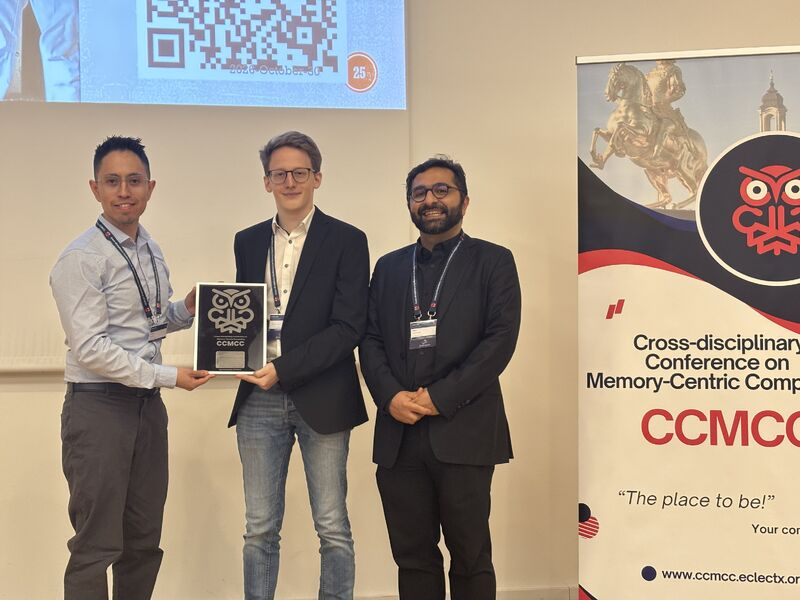
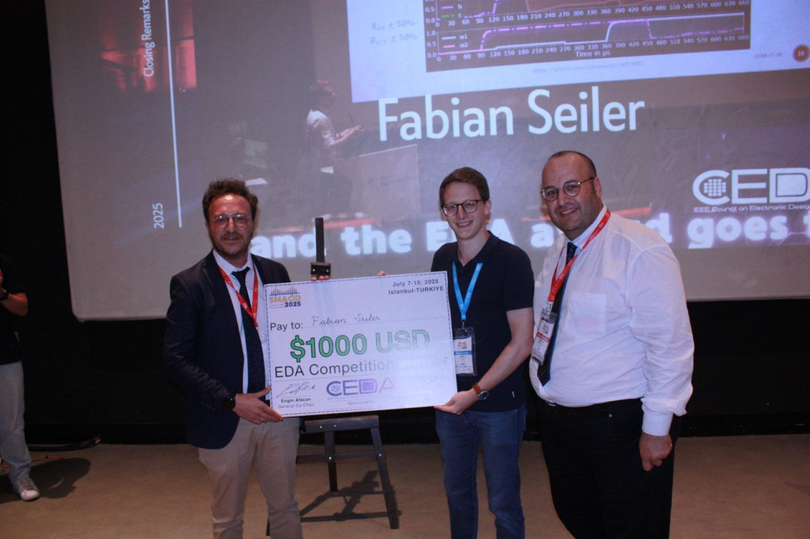
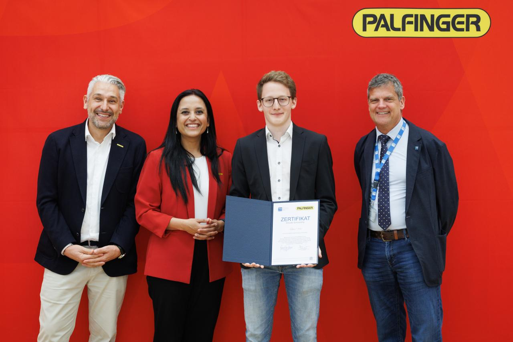

## Awards and Honors

### CCMCC 2026 — Best Paper Award

O. Caisaluisa, **F. Seiler**, L. Prócel, M. Lanuzza, A. Quotb, N. Taherinejad, E. Garzón, *"Reliability and Assessment of an MRAM-based Non-Volatile Precharge-Free Ternary CAM for Real-Time Edge Inference"*

### SMACD 2025 — EDA Competition Winner

**F. Seiler**, Peter M. Hinkel, A. Jantsch, N. Taherinejad, *"ATOMIC: Automatic Tool for Memristive IMPLY-based Circuit-Level Simulation and Validation"*

## Scholarships

### 2025 — Palfinger ELEVATE Scholarship

Awarded to the best Embedded Systems student at TU Wien.

### 2020–2025 — Annual Merit Scholarships

Awarded by TU Wien.